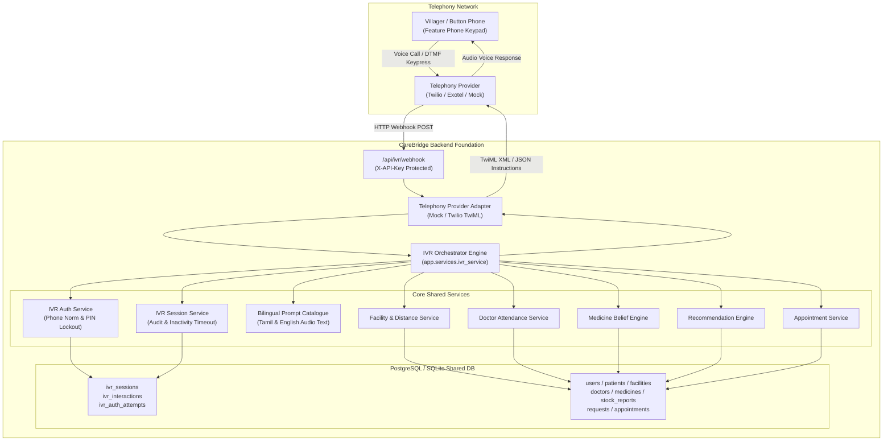
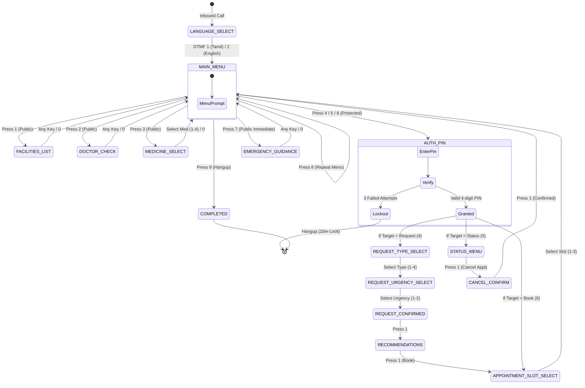

# CareBridge Voice Access (IVR) — Architecture

**Module Name:** CareBridge Voice Access  
**Feature:** Button Phone / Feature Phone Healthcare Access  
**Tagline:** Healthcare access without a smartphone or internet.

---

## 1. Executive Summary

In rural India, millions of citizens either do not own smartphones, lack reliable high-speed cellular internet, or face digital literacy barriers. **CareBridge Voice Access** provides an Interactive Voice Response (IVR) telephone interface allowing any villager using an ordinary button phone (feature phone) to:
- Discover nearby primary and community healthcare facilities with line-of-sight distance estimates.
- Check doctor attendance for the day (strictly distinguishing verified presence from planned schedules).
- Query medicine stock availability powered by CareBridge's probabilistic belief engine.
- Create healthcare requests and receive intelligent facility recommendations.
- Book and cancel healthcare appointments without double-booking conflicts.
- Immediately access emergency 108 ambulance guidance without authentication barriers.

The system is fully bilingual in **Tamil (`ta`)** and **English (`en`)**, relies strictly on **DTMF (dual-tone multi-frequency) keypad inputs**, and is completely provider-independent.

---

## 2. High-Level System Architecture

---

## 3. Component Responsibilities

### 3.1. Telephony Provider Adapter (`app/integrations/telephony/`)
- **`TelephonyProvider` (Base Interface)**: Defines abstract contracts:
  - `validate_inbound_webhook`: Verifies cryptographic carrier signatures (`X-Twilio-Signature` HMAC-SHA1).
  - `parse_webhook`: Normalizes carrier payloads into unified `TelephonyCallEvent`.
  - `format_response` / `generate_voice_response`: Converts `IVRResponse` into carrier format (TwiML XML for Twilio, JSON for mock).
  - `initiate_outbound_call`: Dispatches outbound calls via provider REST APIs (e.g. Twilio Calls API).
  - `transfer_call`: Generates carrier transfer instructions (TwiML `<Dial>`).
  - `terminate_call`: Instructs carrier to safely disconnect.
  - `get_call_status`: Queries live carrier call lifecycle status.
- **`TwilioTelephonyProvider`**: Parses Twilio application/x-www-form-urlencoded webhooks (`CallSid`, `From`, `Digits`, `CallStatus`), enforces HMAC-SHA1 signature verification, and generates standard TwiML XML (`<Response><Gather><Say language="ta-IN">...</Say></Gather><Dial>...</Dial><Hangup/></Response>`).
- **`MockTelephonyProvider`**: Parses and renders structured JSON payloads for headless testing, CI/CD automated validation, and the interactive terminal simulator.
- **`get_telephony_provider`**: Factory dynamically selecting active provider based on `TELEPHONY_PROVIDER` or `IVR_PROVIDER`.

### 3.2. Public Carrier Webhook Endpoints (`app/api/v1/ivr.py`)
- **`POST /api/ivr/webhooks/incoming`**: Carrier entrypoint for inbound calls. Validates `X-Twilio-Signature`, creates `IVRSession`, and returns initial welcome and language selection TwiML.
- **`POST /api/ivr/webhooks/continue`**: Carrier DTMF gather callback. Validates signature, routes keypress through IVR state machine, and returns next menu TwiML.
- **`POST /api/ivr/webhooks/status`**: Carrier call status lifecycle webhook tracking `ringing`, `in-progress`, `completed`, `busy`, `no-answer`, and `failed` events to mark sessions `COMPLETED` upon disconnect.
- **`POST /api/ivr/callbacks/initiate`**: Authenticated API endpoint to dispatch automated outbound telephone calls for ASHA follow-ups or appointment reminders, strictly enforcing Indian calling hours (08:00 to 20:00 IST).
- **`POST /api/ivr/webhook`**: Unified legacy entrypoint maintained for full backwards compatibility with existing clients.

### 3.3. Caller Identification & Security Service (`app/services/ivr_auth_service.py`)
- **Phone Normalization**: Normalizes incoming Indian telephone numbers (stripping `+91`, leading `0`, punctuation) to uniform 10-digit format (`9876543201`).
- **Caller Lookup**: Queries `User` and `Patient` records by phone.
- **PIN Verification**: Authenticates callers using their securely provisioned 4-digit PIN verified against stored bcrypt password hashes. For local development and automated simulation only, phone-derived PIN (last 4 digits) is conditionally supported when `IVR_ALLOW_DEMO_PHONE_PIN=True` and `ENVIRONMENT!=production`, but is strictly blocked in production.
- **Brute-Force Lockout**: Enforces a strict maximum of 3 failed PIN attempts. Upon the 3rd consecutive failure, the caller is locked out for 15 minutes (`IVR_AUTH_LOCKOUT_MINUTES`) and the active call is terminated.
- **Constant-Time Comparison**: Protects system credentials and API keys via `secrets.compare_digest`.

### 3.3. Bilingual Prompt Manager (`app/services/ivr_prompt_service.py`)
- Maintains culturally sensitive, grammatically natural spoken prompts in **Tamil** and **English**.
- Formats dynamic information (facility names, straight-line distances, doctor schedules, medicine stock confidence percentages, appointment time slots).
- Strictly communicates medical safety boundaries and emergency notices.

### 3.4. Session & Interaction State Manager (`app/services/ivr_session_service.py`)
- Tracks active telephone sessions in `ivr_sessions` with 10-minute inactivity timeout protection.
- Logs every DTMF interaction, prompt played, and system action in `ivr_interactions` for auditability and healthcare worker follow-up.

### 3.5. IVR Orchestrator Engine (`app/services/ivr_service.py`)
- Implements the complete DTMF Finite State Machine (FSM).
- Directly reuses shared backend core services:
  - `FacilityServiceHandler` & `DistanceService`: Facility discovery and distance calculation.
  - `DoctorServiceHandler`: Doctor schedule and verified attendance retrieval.
  - `AvailabilityService`: Probabilistic medicine availability calculations ($p$, confidence, label).
  - `generate_recommendations`: Multi-factor recommendation algorithm scoring candidate facilities.
  - `Appointment`: Slot reservation and conflict prevention.

---

## 4. IVR Menu State Machine

---

## 5. Medical Safety & Ethical Constraints

CareBridge Voice Access adheres strictly to clinical safety and data integrity boundaries:
1. **Zero Diagnostic Claims**: The IVR system strictly acts as a logistics and navigation coordinator. It never attempts symptom diagnosis, triage scoring, medication substitution, or dosage prescription.
2. **Immediate Emergency Access**: Option 7 (Emergency 108 Guidance) is available immediately from the main menu without requiring authentication, personal identification, or complex menu traversals.
3. **Strict Doctor Attendance Semantics**: The system explicitly announces doctor attendance as planned (`EXPECTED`) vs confirmed on-site (`PRESENT`). It never claims a scheduled doctor is verified present unless verified in the database.
4. **Probabilistic Stock Integrity**: Spoken medicine stock reports explicitly inform callers that availability is an estimate (`LIKELY`, `UNCERTAIN`, `UNLIKELY`), disclose confidence staleness, and warn callers to verify with local health workers before travelling long distances.
5. **Caller Feedback Separation**: Caller feedback submitted via button phone keypad is tagged strictly as `PATIENT` feedback and never alters inventory probabilities directly.
